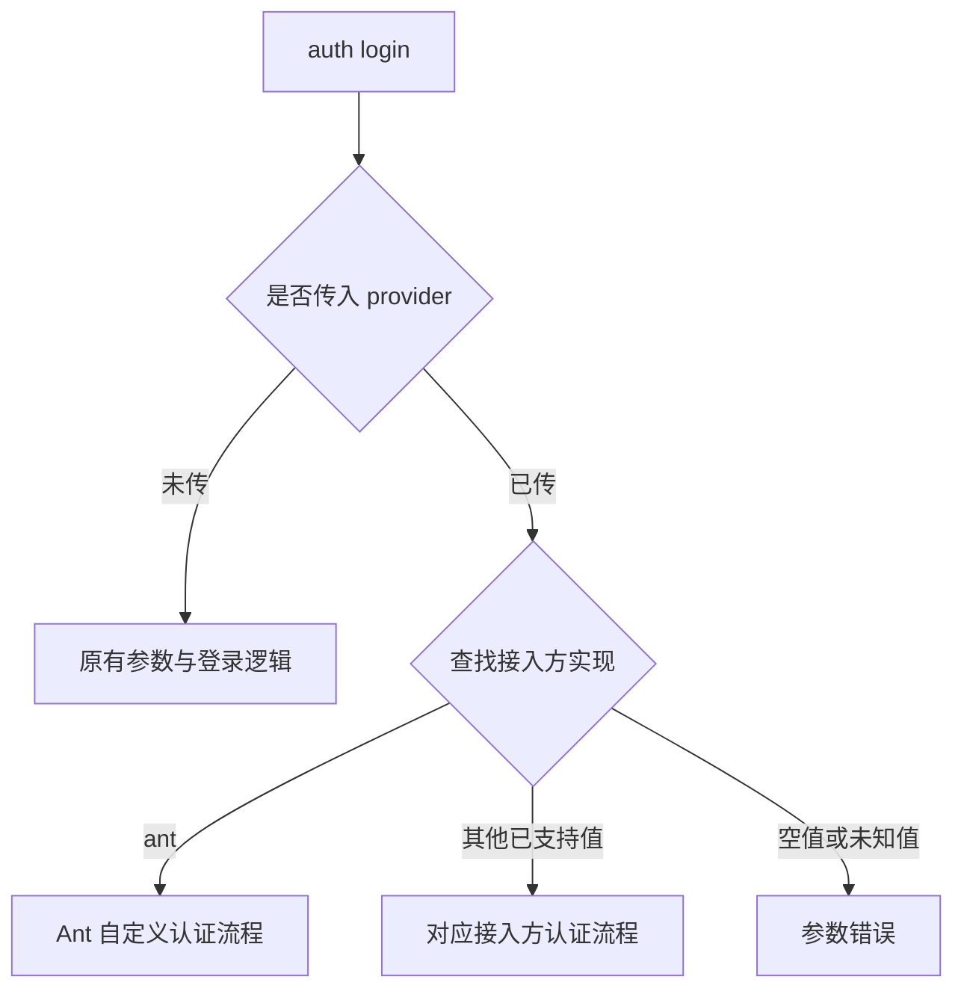
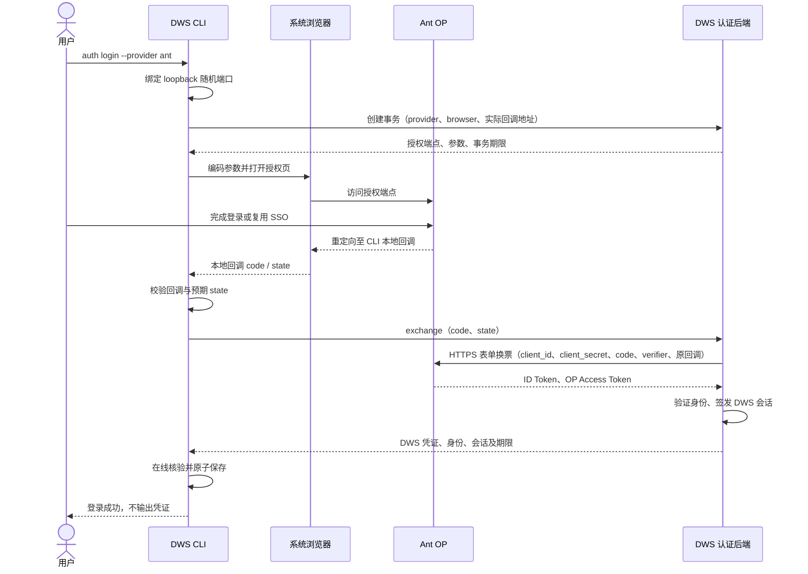

# 蚂蚁身份接入 DWS：开发计划与技术方案

> 历史方案参考（2026-10-15）：本文保留早期讨论内容。当前已实现的 OIDC 接入以相邻 portal 仓库的 [协议与联调说明](../../lippi-openmcp-portal/docs/dws-oidc-backend.md) 和 [OpenAPI](../../lippi-openmcp-portal/docs/dws-oidc-openapi.json) 为准；当前 ant 流程先用 transactions 检查配置，成功后由 SDK 直接返回 code/state，再调用 exchange；已移除 ant 浏览器授权与本地回调。本期不包含旧稿中的 interaction_mode、取消或会话恢复接口。
>
> CLI 面最终决策（2026-10-16）：不再复用 `auth login --provider` 分发，改为独立命令 `dws auth provider-login <provider>`；`auth login` 保持原有钉钉登录行为零侵入。

> 业务编排入口最新决定（2026-10-16）：采用 `auth exchange-prepare --provider ant` → 业务按原参数调用 IdP／SDK → `auth token-exchange --provider ant --code ... --state ...`，复用 Portal 现有 OIDC 事务接口。§1.3、§5 为当前方案；其余历史方案 A、浏览器和旧 authExchange 描述不作为本入口的实施依据。

历史状态记录（2026-10-15；当前分步换票交付以 §1.3、§5 为准）：独立 provider 对象与分发层已实现；用户已明确使用 client_secret_post 获取 ID Token，方案据此按 OIDC 授权码流程推进。OP 应用登记、DWS 事务 API 和会话生命周期仍需对齐；本次同步协议文档，尚未实现 Ant 登录及 CLI 接线。此前提前写入的旧认证实现、测试和发布说明已撤回。

## 1. 目标与已确定的需求

目标入口：

```sh
dws auth login --provider ant
```

用户已选择的交互是：打开 BUC 登录页，用户完成登录后自动保存 DWS 登录态。省略 `--provider` 时保持现有钉钉登录行为。

### 1.1 已确定：按 provider 分发登录逻辑

`auth login` 保持统一命令入口，`--provider` 用于选择接入方的认证实现。不同接入方可以使用不同认证协议和交互流程。

| 命令 / 输入 | 分发行为 |
| --- | --- |
| `dws auth login` | 直接执行原有登录逻辑 |
| `dws auth login` 加原有参数，未传 `--provider` | 按原有参数解析、校验和登录流程执行；新增 provider 功能不改变这些行为 |
| `dws auth login --provider ant` | 执行 Ant 自定义认证逻辑，不再进入原有登录流程 |
| `dws auth login --provider <其他已支持接入方>` | 执行该接入方注册的认证逻辑；这里仅定义扩展规则，不表示本期已有其他接入方 |
| 未知 provider | 返回不支持的 provider 参数错误，不回退旧登录 |
| 显式 `--provider` 缺少值或值为空 | 返回参数错误；与完全不传 `--provider` 区分 |

分发依据是本次命令是否显式传入 `--provider` 及其值。不能根据历史 profile、现有 token 或环境配置暗中选择 Ant。选中的接入方认证失败时，返回该流程的失败，不自动执行另一接入方或旧登录流程。



### 1.2 分发层与认证协议分开设计

登录分发层只负责选择实现，不强制所有接入方使用 OIDC、BUC、SDK 或同一换票接口。本次 Ant 按 OIDC 获取 ID Token，并由后端采用 client_secret_post；这是该接入方的协议设计，不影响“无 provider 走旧逻辑”或其他接入方自行选择协议的规则。

后续拟采用显式注册的接入方处理器，约定各自的参数校验、认证入口和结果交付。接入方决定授权方式、协议客户端和专属参数；新增接入方通过增加实现并注册接入，不把专属判断不断塞入原有登录函数。此处的注册是代码中的实现映射，不代表需要新增本地配置文件或动态加载任意外部代码。

用户已确认以下对象划分（Go 使用 struct + interface）：

| 对象 | 职责 |
| --- | --- |
| `ProviderLoginService` | 显式注册、按名称选择并调用接入方；不调用旧登录，不做跨接入方回退 |
| `LoginProvider` | 统一的 `Name`、`Validate`、`Login` 接口；具体协议依赖由实现对象构造时注入 |
| `AntLoginProvider` | Ant 专属认证实现；对接 DWS OIDC 事务 API，OP 的 client_secret_post 由后端执行 |
| `ProviderLoginOptions` | 只承载已确认的公共选项 `NoBrowser` 和交互输出；取消与超时使用 context |

第一步的分发服务在构造时校验名称及重复注册，之后注册表只读。调用时先验证选中的接入方参数，再启动该实现；校验失败或取消后不启动认证。校验错误采用现有 validation 分类，认证业务错误保留原分类。认证结果暂复用 `TokenData`；协议特有字段和保存、刷新策略依据冻结的 DWS 事务及会话契约单独设计，不提前假定。

当前进度：已新增 `internal/auth/provider_login.go` 中的 `ProviderLoginService`、`LoginProvider` 和 `ProviderLoginOptions`，以及对应单元测试。定向测试、race 检查和 `go vet` 已通过，Go 与通用代码评审均无待处理问题。当前仅完成对象层，尚未增加实际 CLI 的 `--provider` 参数、注册 `AntLoginProvider` 或接入凭证保存；后续依据 DWS 事务接口契约继续。原有登录路径未改动。

原有登录路径继续调用现有流程，避免为引入 provider 而重写既有认证。新接入方可共用已核实适用的身份核验、安全存储、错误处理和结果输出能力；刷新、取消等能力按各自协议接入，不强制假设所有 provider 都具备。

分发应在原有登录业务专属配置和校验之前完成：未传 provider 才进入原有流程；已传 provider 则进入对应校验与认证流程。通用 CLI 参数解析仍保留，具体参数是否兼容由选中的认证实现明确校验。

### 1.3 业务编排登录需求

业务通过两个已实现命令拆分现有 OIDC 登录流程：

```sh
dws auth exchange-prepare --provider ant --format json
```

业务保存 exchange-prepare 返回的 state，把完整 authorization_request 原样交给 IdP／SDK；身份源验证用户登录态后签发 code，并返回原 state。业务确认返回 state 与本次原值一致，再兑换：

```sh
dws auth token-exchange --provider ant --code "<一次性授权码>" --state "<本次原state>" --format json
```

exchange-prepare 调用 `/cli/auth/oidc/transactions`，token-exchange 调用 `/cli/auth/oidc/exchange`。两者对应的后端接口和 CLI 命令均已实现。code 是按本次 DWS 授权参数签发的授权码，不接受 BUC access token 或不带本次事务绑定的旧业务码。code_verifier 由 Portal 保存；业务只传递 code_challenge、S256、nonce、state 及其余原授权参数。

新命令要求 --provider，并提交 provider/code/state；Portal 已增加可选 provider 字段，传入时校验其与事务中 provider 一致，不一致返回 400 provider_mismatch / restart_login，不向 IdP 换票；事务已消费，需要重新 exchange-prepare 并取码。旧调用不传 provider 时保持原行为。可选 client_id/client_secret 必须成对，仅用于 DWS 应用选择。默认返回 Token，显式 --save 才在线核验身份并保存；--code 与 --code-stdin 二选一。完整命令与参数定义见 [业务编排登录方案](./ant-buc-dws-integration.md)。

### 1.4 已确定：client_secret_post 获取 ID Token

2026-10-15 用户指定使用 `client_secret_post`。沿用现有分工，由 **DWS 认证后端调用 OP Token 端点**；CLI 只向 DWS 提交 code/state，接收最终 DWS 凭证。

```http
POST <configured OP HTTPS token_endpoint>
Content-Type: application/x-www-form-urlencoded
Accept: application/json

grant_type=authorization_code&client_id=<registered client id>&client_secret=<backend-held client secret>&code=<authorization code>&redirect_uri=<original redirect_uri>&code_verifier=<backend-held verifier>
```

实际请求对所有值作 UTF-8 表单编码。`client_secret_post` 是客户端认证方式，`grant_type` 仍为 `authorization_code`；先通过包含 `openid`、nonce、PKCE S256 的授权请求获得 code，再换取 ID Token。OP 登记配置为 `token_endpoint_auth_method=client_secret_post`，方法名不加入请求正文；不混用 Authorization Basic 或客户端断言。[OIDC 客户端认证](https://openid.net/specs/openid-connect-core-1_0.html#ClientAuthentication)

client_secret 仅由后端密钥系统按 provider、环境和应用管理及轮换，不加入 CLI 参数、授权 URL、回调、Profile 或日志，也不使用现有钉钉登录的 `--client-secret` 代传。ID Token 留在后端校验签名、issuer、audience、期限和 nonce，再映射身份、签发 DWS Token。密钥缺失或 invalid_client 时停止，不降级认证方式。已同步总体设计、SDK 分支和浏览器分支的公共换票规则；这些文档不表示真实服务已经部署。

## 2. 方案依据与需要解决的分歧

| 依据 | 当前说明 | 对开发的影响 |
| --- | --- | --- |
| [在线文章《蚂蚁 BUC 登陆 DWS》](https://alidocs.dingtalk.com/i/nodes/pGBa2Lm8aeP35vxdtzjRnZDP8gN7R35y) | 提出凭证交换及 provider 登录入口 | 定义产品诉求，但浏览器、刷新等协议仍需对齐 |
| 相邻 `lippi-openmcp-portal` 的 `CliOAuthController.authExchange`、`AntAuthExchangeHandler` | 已有 `/oauth2/authExchange` 的服务端代码 | 只能证明仓库有实现，不能据此认定生产已部署或 BUC 浏览器已接通 |
| [OIDC 登录设计](./oidc-login-design.md)（§3 交互协议） | 后端管理事务、state、nonce 和唯一一组 PKCE；CLI 提交 code/state | 协议章节为设计稿，正文标注尚未实现；CLI 已实现部分见 §1 交互方案与 §2 能力 |
| [OIDC 登录设计](./oidc-login-design.md) §1.1：方案一 SDK 授权 | `provider=ant`，SDK 完成授权回传 code/state | SDK 契约以 §4.1 对接方式为准；`interaction_mode` 字段本期未实现 |
| [OIDC 登录设计](./oidc-login-design.md) §1.3：方案三企业 OP 浏览器 | 本地回调，浏览器模式，后端换票 | 设计稿、未实现；其中企业 provider 示例不能直接当作蚂蚁生产配置 |

**关键分歧：协议选型和交互模式是两个独立决定。** 选择 OIDC 不等于选择 SDK；选择浏览器也不意味着现有 BUC 登录页已经具备 OIDC 授权能力。

这项协议选择只影响 Ant 处理器的内部实现，不能改变第 1.1 节已经确定的命令分发规则。

## 3. OIDC 登录方向与兼容方案

| 对比项 | 方案 A：沿用现有业务授权码交换 | 方案 B：后端管理 OIDC 事务 |
| --- | --- | --- |
| 主要接口 | `/oauth2/authExchange` | `/cli/auth/oidc/transactions`、`exchange`、`cancel` |
| 换票输入 | provider、auth_code、可选 client_id | code、state；原应用配置从后端事务读取 |
| 授权前的事务 | 现有接口未定义 | 后端创建并返回结构化授权参数 |
| PKCE / nonce | 现有交换接口未定义 | 按总体设计由后端管理 |
| 浏览器支持 | 还需确认 BUC 登录入口及授权码交付协议 | 按浏览器方案实现，前提是 Ant OP 支持对应登记和回调 |
| 当前成功响应 | access_token、expires_in、provider、corp_id | 拟议返回 Access/Refresh Token、身份、会话及期限 |
| 刷新和取消 | 现有响应无 refresh_token，事务取消未定义 | 总体设计要求刷新、取消及结果恢复能力，需要服务端配套 |
| 实施依赖 | 现有交换服务可用、业务授权码来源明确 | 新服务端协议和应用登记落地 |
| 适用范围 | 已经拿到业务授权码，需要快速换票 | 完整登录生命周期和后续扩展 |

**依据本次获取 ID Token 的要求，完整登录按方案 B 的 OIDC 方向推进，浏览器作为首个交互方式。** 后端向 OP 换票采用已确定的 client_secret_post。三个 DWS 事务 API 仍是现有设计中的拟议接口，需与服务端对齐；不能将客户端认证方式的确定视为服务端已实现。方案 A 作为独立兼容需求评估，不能在 B 不可用时静默回退。

若本期只需要对接已有换票接口，则选择方案 A，并把交付边界明确为“外部业务授权码换票”；不能在没有浏览器协议的情况下把该能力标为“BUC 浏览器登录完成”。

## 4. OIDC 方案的职责划分

| 组件 | 拟承担职责 | 本轮计划边界 |
| --- | --- | --- |
| DWS CLI | 本地监听、创建事务、浏览器交互、code/state 校验、提交兑换、核验及保存、取消与失败处理 | 后续拟在本仓库开发 |
| DWS 认证后端 | 可信 provider 配置、密钥管理、事务状态机、PKCE、client_secret_post 换取 ID Token、验证身份、账号映射、DWS 会话签发及撤销 | 外部依赖；不因为 CLI 开发而自动修改相邻服务端仓库 |
| Ant 身份服务 | 登录、应用登记、授权码、Token 端点与身份声明 | 接入方提供并确认 |
| SDK 适配器 | 把统一授权参数传给 SDK，返回与本次调用关联的 code/state | 后续可选；本期不默认纳入 |

CLI 不保存上游 `client_secret`、`code_verifier`、OP Token 或 ID Token，也不自行生成第二组 PKCE。上游 OIDC client ID 与最终 DWS Token 的 client ID 分别建模，不能混用。

### 4.1 浏览器登录流程



按现有总体设计，用户登录期间 CLI 等待本地回调，不轮询后端。收到 code 后，仅在协议允许的处理中或恢复场景重试同一组 code/state。

### 4.2 拟对接接口

以下是现有 OIDC 文档中的拟议接口，不视为已部署接口。详细字段以评审后冻结的总体设计为准。

| 方法及路径 | CLI 请求 | 主要响应 / 行为 |
| --- | --- | --- |
| `POST /cli/auth/oidc/transactions` | 浏览器模式提交 `provider`、`interaction_mode=browser`、实际 `redirect_uri` | HTTP 201，`authorization_request={authorization_endpoint, parameters}` 与事务期限 |
| `POST /cli/auth/oidc/exchange` | 仅 `code`、`state` | 完成时返回 DWS 凭证、身份及会话；处理中响应与重试期限按冻结协议执行 |
| `POST /cli/auth/oidc/cancel` | 按现有设计提交 `state` | 标记取消，按事务状态处理本次会话；CLI 不把请求发出当作撤销已成功 |
| DWS 会话刷新 | 使用 DWS Refresh Token，具体端点及绑定信息待确认 | 必须与现有刷新机制明确兼容或提供独立适配 |

创建响应的 `parameters.state` 是 CLI 的预期 state 来源；浏览器回调地址必须等于已绑定的实际地址。CLI 对授权端点的信任、字段完整性和期限进行检查，不能接受任意重定向后携带凭证继续请求。

总体设计当前明确不增加 `transaction_id`、`transaction_token` 或额外临时 Cookie。本计划不擅自改变该契约。其已记录的限制是：持有有效 code/state 的其他调用方可能取得或重取结果，state 泄漏也可能导致取消。这是协议评审项；如决定增加发起端绑定，须先修订协议，不能只在 CLI 单方加参数。

### 4.3 CLI 行为提案

| 项目 | 拟定行为 |
| --- | --- |
| `auth login --provider ant` | 分发给 Ant 处理器执行本节 OIDC 浏览器流程，成功自动保存 |
| 未传 provider | 直接保留原有参数校验与钉钉登录路径，不进入新 provider 流程 |
| 其他 provider | 分发给对应的已注册处理器，各自选择认证协议；不默认套用 Ant 的 OIDC 流程 |
| `--no-browser` | 输出同一次事务的授权链接，用户手动打开；仍需能访问 CLI 本机回调 |
| 超时 / Ctrl-C | 结束等待、关闭监听，按协议执行有界取消；保留原有本地凭证 |
| 本地保存 | 以在线核验后的 corp_id:user_id 保存，原子提交，失败回滚 |
| 默认 profile | 建议保留已有默认身份；首次登录初始化默认身份，最终在需求评审确认 |
| 输出 | login 沿用现有输出契约；成功显示身份和有效期，不输出 Access/Refresh Token |
| `--client-id` / `--client-secret` | Ant 的 OP 应用及 client_secret_post 密钥由后端配置；不支持用这些 CLI 参数重选上游应用或上传密钥；不改变旧登录参数含义 |
| `--token` / `--device` / `--intl` 等 | 与 Ant provider 的互斥规则在协议冻结时逐项明确，错误需在打开浏览器前返回 |
| SSH / 跨机器浏览器 | 本地回调不能直接覆盖跨机器场景；本期不默认添加新的远程交付机制 |

用户选择的是浏览器方式，因此不能因 SDK 文档使用 `provider=ant` 就将命令默认实现为 SDK。若 Ant 不支持所需浏览器授权能力，需回到方案评审重新选择交互方式。

### 4.4 模块与复用点

| 位置 | 后续拟修改内容 |
| --- | --- |
| `internal/auth` | 接入方认证入口契约与具体处理器；Ant 增加 DWS OIDC 事务客户端、登录编排、浏览器适配和协议结果校验；通过实例依赖支持隔离测试；OP 换票及密钥留在后端 |
| `internal/app/auth_command.go` 与 auth 相关入口 | 根据 provider 分发；未传参数时调用原有登录；选定 provider 后执行对应参数验证、身份查询注入、输出和取消处理 |
| 现有身份与持久化能力 | 评估复用 `ManagedIdentityResolver`、请求级 token 查询及精确 profile 保存事务，补齐新会话/刷新元数据 |
| root 凭证处理及日志脱敏 | 防止授权输入污染全局身份，覆盖正常结束和所有早退路径；不记录 code/state/Token |
| Schema / help | 在现有 Auth 管理命令边界内审查；若新增公开叶子，明确声明或精确排除，运行反向完整性检查 |

不直接复用绑定旧换票端点的整条业务流程。可复用存储、身份校验、错误与输出基础设施，但协议 DTO、应用身份及刷新方式应保持明确边界。

B 方案的 provider、应用和授权端点以服务端可信登记为权威；不预先把本地 `auth-providers.json` 固定为产品必需配置，也不内置猜测的 Ant 地址或应用 ID。

## 5. exchange-prepare 与 token-exchange 的交付边界

- 已实现 `auth exchange-prepare --provider <provider>`：复用现有事务 API，校验并输出授权对象及有效期，不执行 SDK 取码或本地保存。
- 已实现 `auth token-exchange --provider <provider> --code <code> --state <state>`：复用现有兑换 API；--code 与 --code-stdin 二选一，provider 和 state 必填，client-id/client-secret 成对。Portal 校验所传 provider 与事务一致，不允许跨身份源兑换。
- 业务负责原样传递 exchange-prepare 参数，保存并核对 SDK 返回 state。Portal 保存唯一一组 verifier，校验 nonce 和 PKCE；不由业务或 CLI 生成第二套参数。
- Portal 沿用现有 Token 返回对象与身份签发链路，exchange 已增加可选 provider 字段及一致性校验，兼容旧调用不传该字段；不新增旧 authExchange 接口。idp-reference 的现有 OIDC 取码、换票和 JWKS 可以复用，真实 SDK 的调用仍由接入业务适配。
- 默认返回 Token；--save 复用在线身份核验和安全存储，保留已有默认账号，不回显 Token。CLI 继续使用原 TokenData 和解析器，新命令按仓库约定声明统一输出及 Schema。
- 覆盖 code/state 配对、provider 不匹配及旧调用兼容、授权参数完整性、nonce/PKCE、过期和重复消费、应用凭据成对、默认不保存与保存失败边界；不自动重试一次性兑换。
- 既有 provider-login 保持完整自动编排；此处为业务接管中间取码步骤提供两个独立 CLI 入口。

## 6. 开发计划与阶段验收

独立对象及分发结构已获确认，P2 中协议无关的部分已完成；本次确定了 OP 的 client_secret_post。Ant 事务客户端、CLI 的生产接入及真实联调仍依赖 P0/P1 的接口及登记事实。后端工作列作依赖，不自动扩大本仓库任务范围。

| 阶段 | 主要工作 | 交付物 | 进入下一阶段的条件 |
| --- | --- | --- | --- |
| P0：确认范围和接入条件 | OIDC/client_secret_post 方向已定；落实 Ant 浏览器能力、应用登记、是否并行交付 token-exchange、是否纳入 SDK | 登记结论、CLI 参数表、明确的本期范围 | 接入方提供必要协议依据 |
| P1：冻结接口契约 | 确认请求/响应、错误码、期限、幂等重试、取消、刷新、应用及身份映射 | 接口契约、成功/失败示例、联调环境与责任分工 | 不再用示例域名或假设字段填补协议空缺 |
| P2：分发与接入方认证能力 | 先建立 provider 分发及旧登录兼容边界，再实现 Ant 协议客户端、响应校验、身份和存储适配 | 分发规则测试、服务层实现和隔离契约测试 | 未传 provider 的行为保持；接入方之间不会串流；失败不覆盖已有登录态 |
| P3：浏览器与 CLI 接入 | Ant 的 loopback 回调、专属参数互斥、输出、取消和退出清理 | 用户可执行的登录入口及 CLI 测试 | 真正的服务端协议闭环通过；默认钉钉流程兼容 |
| P4：真实联调和发布准备 | 使用登记的 Ant 应用验证登录、刷新、取消、后续业务命令 | 联调记录、帮助文档、发布说明 | 验收矩阵通过，明确剩余限制后再决定发布 |

可先由后端提供与冻结契约一致的 mock，让 CLI 开发并行推进；mock 测试通过不作为真实接入已完成的依据。若后端或 Ant 登记未就绪，停留在可验证阶段，不把协议猜测写成生产行为。

## 7. 验收矩阵

| 方面 | 必须覆盖的行为 |
| --- | --- |
| provider 分发 | 未传参数只调用旧流程；ant 只调用 Ant；其他已注册接入方只调用自己的实现；空值/未知值报参数错误；失败不跨流程回退 |
| 正常登录 | BUC 登录 → code/state → DWS 凭证 → 在线核验 → 保存 → 执行一个只读业务命令 |
| 回调 | 先监听后授权；限制 loopback、Host、路径、方法；拒绝缺失/重复/错误 state；一次合法交付 |
| HTTP 协议 | HTTP 错误、畸形/超大响应、字段缺失、期限不一致、重定向、超时与取消 |
| OP 客户端认证（后端验收） | client_secret_post 以表单提交 client_id/client_secret；正确处理特殊字符；缺失/错误密钥停止，无 Basic 混用或认证降级；密钥不流入 CLI 或日志 |
| 事务处理 | 按最终契约验证 202 处理中、相同 code/state 重试、不同 code 冲突、结果恢复和取消竞争 |
| 身份与存储 | 在线身份缺失或不一致时不保存；精确 profile；默认账号保持；失败回滚 |
| 会话生命周期 | DWS 刷新协议确实可用；过期、撤销、本地保存失败后的会话清理结果明确 |
| 兼容性 | 无 provider 时既有参数组合、校验、登录和输出均保持；provider 专属校验不进入旧路径；help、错误分类和重复执行一致 |
| 凭证保护 | 命令日志、诊断、错误正文和回调页面不泄露凭证；保存模式不输出 token |

后续编码阶段的验证包括：适当的单元/契约测试、auth 与 app 回归、竞态测试、`make build`、全量测试、生成漂移和 Schema 门禁。自行构造的命令测试使用框架执行辅助函数；不把生成 Catalog 提交为新的声明来源。

## 8. 方案评审需要确定的事项

provider 分发规则、浏览器交互和 OP 的 client_secret_post 已经确定，不再作为待选项；以下仅对齐 DWS 编排接口、接入条件及交付范围。

**产品和范围决定：**

1. DWS 事务接口是否按总体设计的创建、兑换和取消契约落地，实施责任及联调时间是什么？
2. `auth login --provider ant` 继续按已选择的浏览器交互规划；SDK 是否明确放到后续？
3. 旧 `token-exchange` 是否与浏览器登录同批交付，还是作为独立兼容阶段？

**接入方需提供的事实：**

- Ant 是否支持所需 OIDC 浏览器授权、后端 client_secret_post 与动态 loopback 回调的组合登记；正式端点、环境及后端密钥配置方式是什么。
- DWS 后端三个 OIDC 接口的可用地址与版本；若独立交付旧 token-exchange，另行确认 authExchange 的实际部署和凭证来源。
- DWS Refresh Token 的刷新端点、会话撤销接口及权限模型是否已经具备。
- 最终身份映射、登录期限、结果恢复期限、重试与取消行为。

当前独立对象与分发层已完成，OP 获取 ID Token 的方式已明确；后续依据冻结的 DWS 事务契约继续 Ant 接入和联调。未知协议不以占位成功、猜测端点或旧协议静默回退代替。
