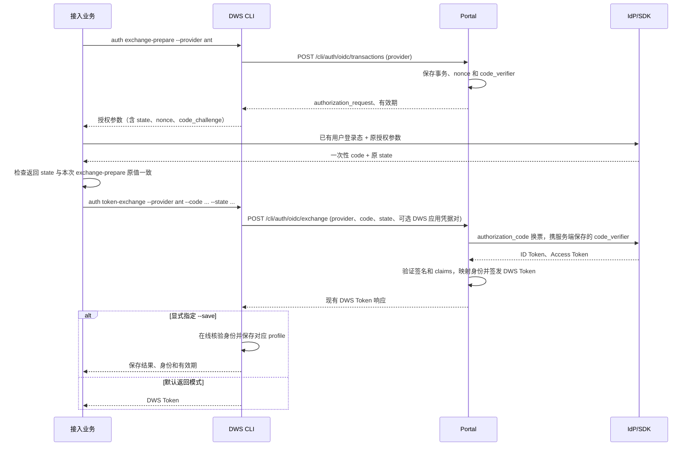

# 业务编排 DWS 登录：exchange-prepare 与 token-exchange

> 方案更新（2026-10-16）：业务先获取 DWS 登录事务参数，再调用 IdP／SDK 取得绑定该事务的一次性授权码，最后兑换 DWS Token。下文两个 CLI 命令已实现；Portal 已有对应接口，协议以 [Portal OIDC 说明](../../lippi-openmcp-portal/docs/dws-oidc-backend.md) 为准。

## 1. 交互流程

业务负责把 DWS 返回的授权参数原样交给 IdP／SDK，由身份源验证用户登录态并签发 code。DWS CLI 接收该 code 和原 state，不接收 BUC access token。



## 2. exchange-prepare：创建事务并交付授权参数

命令：

```sh
dws auth exchange-prepare --provider ant --format json
```

| 参数 | 约束与用途 |
| --- | --- |
| `--provider <provider>` | 必填且非空，选择 Portal 登记的身份源。 |
| `--format json` | 使用 JSON 输出授权参数，供业务读取。 |

命令调用 `POST /cli/auth/oidc/transactions`，请求体为 `{"provider":"ant"}`。provider 使用 Portal 已登记的名称；当前 ant 流程使用 `ant`。该命令不调用 SDK、不生成 code、不保存或切换本地登录身份。

通过统一结果框架返回 Portal 的 `provider`、`expires_in` 和 `authorization_request`。业务读取 `data.authorization_request`，保留本次 state，并在有效期内把完整授权对象交给对应 SDK／IdP。授权参数的职责如下：

| 参数 | 处理方式 |
| --- | --- |
| `client_id` | IdP 登记的 SP 应用标识，由 Portal provider 配置提供。 |
| `response_type`、`scope`、`redirect_uri` | 原样传递；当前为 code 流程，scope 包含 openid，redirect_uri 来自服务端登记。 |
| `state` | DWS 创建的事务标识。业务保存原值，检查 SDK 返回值一致，再原样提交兑换；作为不透明字符串处理。 |
| `nonce` | IdP 绑定到 code，签发 ID Token 时原样带回，由 Portal 校验。 |
| `code_challenge`、`code_challenge_method` | IdP 绑定到 code；当前使用 S256。 |
| `code_verifier` | 只保存在 Portal，exchange-prepare 不返回；后端向 IdP 换票时使用，业务和 CLI 不生成或传入。 |

业务可以使用已有的 BUC 登录态向身份源取码；用户登录态只用于该取码过程，不作为 DWS 命令参数。授权码须绑定本次请求的 client_id、redirect_uri、nonce 和 challenge，并按身份源协议短期有效、单次消费。`idp-reference` 已示范这套取码和换票语义；真实接入仍需对接实际 SDK／IdP。

## 3. token-exchange：提交 code 和 state

业务先校验 SDK 返回的 state 与 exchange-prepare 时保存的原值完全一致，再调用命令：

```sh
dws auth token-exchange \
  --provider ant \
  --code "<IdP返回的一次性授权码>" \
  --state "<本次exchange-prepare返回的原state>" \
  --format json
```

| 参数 | 定义 |
| --- | --- |
| `--provider <provider>` | 必填，必须与本次 exchange-prepare 的 provider 一致；不覆盖 state 绑定的身份源。 |
| `--code <code>` | 本次授权参数对应的一次性授权码；不接受 BUC access token。 |
| `--code-stdin` | 从标准输入读取 code，与 `--code` 必须且只能选择一个；仅去掉末尾一个 LF 或 CRLF，保留其他字符，不重新编码 code。 |
| `--state <state>` | 必填，传入本次 exchange-prepare 的原 state；不拆解或重建。 |
| `--client-id <clientId>`、`--client-secret <secret>` | 可选的 DWS 应用凭据，必须一起出现或都不出现，仅用于签发最终 DWS Token。 |
| `--save` | 默认 false；指定后在线核验身份并保存，不回显 Token。 |
| `--format json` | 通过统一结果框架输出机器可读结果。 |

命令调用 `POST /cli/auth/oidc/exchange`，提交 `provider`、`code`、`state`，可选字段为 `client_id`、`client_secret`。Portal exchange 已接受可选 provider：传入时必须与 state 对应事务中的 provider 一致，不一致返回 `400 provider_mismatch`、`action=restart_login`，不向 IdP 换票。沿用先消费事务的规则，该 state 不可重用，须重新 exchange-prepare 并取码；旧调用方不传 provider 时仍使用事务中的 provider。IdP 应用参数继续取自已保存事务。接口字段沿用现有 `code`，不新增 `auth_code` 别名。

两组 client_id 用途不同：exchange-prepare 返回的是 IdP 的 SP 应用标识；token-exchange 的可选凭据对选择最终 DWS 应用。未提供凭据对时，沿用 Portal 配置的默认 CLI 应用。旧稿中“只传 client-id、按 provider 反查默认应用”的交换规则被这套现有接口语义替代。

两个命令统一读取系统 MCP 地址：优先使用配置目录中的 `mcp_url` 文件，否则使用默认地址。配置目录由 `DWS_CONFIG_DIR` 指定，未设置时为 `~/.dws`；命令不修改端点配置。正式地址必须为 HTTPS；仅 loopback 开发地址允许 HTTP。两步必须使用同一个 Portal 环境。支持 `--dry-run` 仅检查参数并返回计划，不读取 stdin、不联网、不保存。

## 4. 结果与保存

默认返回 DWS Token，不写入本地槽位、不切换当前 profile。Portal 继续返回现有 `accessToken`、`refreshToken`、`expiresIn`、`corpId`、`corpName`；CLI 复用现有解析器和 TokenData，不增加另一种 Token 对象。JSON 使用统一 `ok/outcome/data/meta` 信封；TokenData 位于 `data`，保留现有 `access_token`、`refresh_token`、`expires_at` 等字段。

指定 `--save` 后，用新 Token 在线核验身份，通过已有安全存储保存精确的 `corpId:userId` profile；保留已有默认账号，空环境首次保存可设为默认。保存模式仅返回保存结果、身份和有效期，不回显 Token。身份核验或保存失败不覆盖原有可用凭证；code、state 和上游登录凭证不写入 Token 槽位。

```sh
dws auth token-exchange \
  --provider ant \
  --code "<IdP返回的一次性授权码>" \
  --state "<本次exchange-prepare返回的原state>" \
  --save \
  --format json
```

后续通过现有 `--profile` 或 `--token` 使用 DWS 凭证。事务或 code 过期、已消费，或兑换结果不确定时，按 Portal 返回的动作重新 exchange-prepare 并取新 code，不自动重试旧 code/state。刷新沿用实际签发凭证支持的能力；自定义 DWS 应用刷新、退出撤销联动等仍按既有遗留事项处理。

## 5. 实现与接入边界

- CLI 已增加 exchange-prepare 与 token-exchange 两个入口，复用现有 OIDC 事务创建、授权参数校验、Token 解析及换票传输；现有 provider-login 继续自动编排完整流程。
- Portal 复用 `/cli/auth/oidc/transactions` 和 `/cli/auth/oidc/exchange`；exchange 已增加可选 provider 字段及事务一致性校验，并兼容不传 provider 的现有调用。不再为本方案新增旧稿的 `/oauth2/authExchange` 或任意外部 Token 校验接口。
- 业务对接真实 IdP／SDK，原样传递授权参数并检查返回 state；在两次 CLI 调用之间由业务管理本次调用上下文。
- `idp-reference` 的 state、nonce、PKCE 取码及换票逻辑可以复用，无需增加 BUC access token 交给 Portal 校验的路径。
- 测试覆盖授权参数完整性、verifier 不外泄、业务端 state 对应关系、code/事务过期与重复消费、provider 不匹配及旧调用兼容、nonce/PKCE 不匹配、应用凭据成对校验、默认不保存及 `--save` 身份保存边界。命令使用 corecmd 声明参数和统一结果，按现有 auth 管理命令规则列入精确的 Schema 排除清单；日志不输出 code、state、client-secret 或 Token。

现有 `auth exchange` 继续用于钉钉授权码登录，不承担此处按 state 绑定事务的兑换。业务编排入口也不另增独立凭证包登录方式。

## 6. 其他身份源与已有登录入口

其他身份源接入时，在 Portal 登记 provider 与 OIDC 应用，并支持相同的 state、nonce、PKCE 授权码流程。业务使用 `auth exchange-prepare --provider <已登记名称>` 取得其授权参数，完成取码后以同一 provider 和 code/state 调用 token-exchange；不能仅填写新 provider 名称就获得身份源接入能力。

如果接入方直接使用钉钉登录，或已经持有钉钉授权码、DWS token，可使用当前已有的入口：

| 接入场景 | 已有指令 | 支持方式 |
| --- | --- | --- |
| 用户在本机通过浏览器完成钉钉授权 | `dws auth login` | 完成登录并保存本地凭证；具备有效刷新凭证时按既有机制续期。 |
| SSH、容器等无浏览器环境 | `dws auth login --device` | 发起设备授权，由用户在可访问的浏览器中完成登录，DWS 获取并保存凭证。 |
| 使用自有钉钉 OAuth 应用 | `dws auth login --client-id "<应用ID>" --client-secret "<应用密钥>"` | 使用该应用完成钉钉用户授权并保存登录态。 |
| 接入业务已取得钉钉授权码 | `dws auth exchange --code "<授权码>" --client-id "<应用ID>" --format json` | 换取 token、在线核验身份并保存 profile；应用必须与授权码匹配，不返回 token。 |
| 已持有 DWS token，希望本地保存 | `dws auth login --token "<DWS-token>"` | 保存已有 access token；不会因此获得真实刷新凭证或自动续期能力。 |
| 已持有 DWS token，希望每次调用时注入 | `dws --token "<DWS-token>" contact user get-self` | 本次调用使用，不写入槽位，由接入方维护凭证。 |

注意：钉钉 `/oauth2/auth` 支持推荐参数 `state` 并在回调原样回显；DWS 的钉钉原生授权链接（`buildAuthURLForRegion`）不下发 `state`，回调只收到 `authCode`（示例 `docs/examples/dingtalk-oauth-callback` 的 `/dingtalk/callback`）。上表中的钉钉既有入口按该形态工作；本方案的事务兑换使用 Portal 下发的 state，由业务保存原值并在取码后原样提交 token-exchange。

上述已有入口保持各自语义。默认返回 Token、显式 `--save` 保存的规则仅适用于本方案的 token-exchange，不自动扩展到已有 auth login 或 auth exchange。
