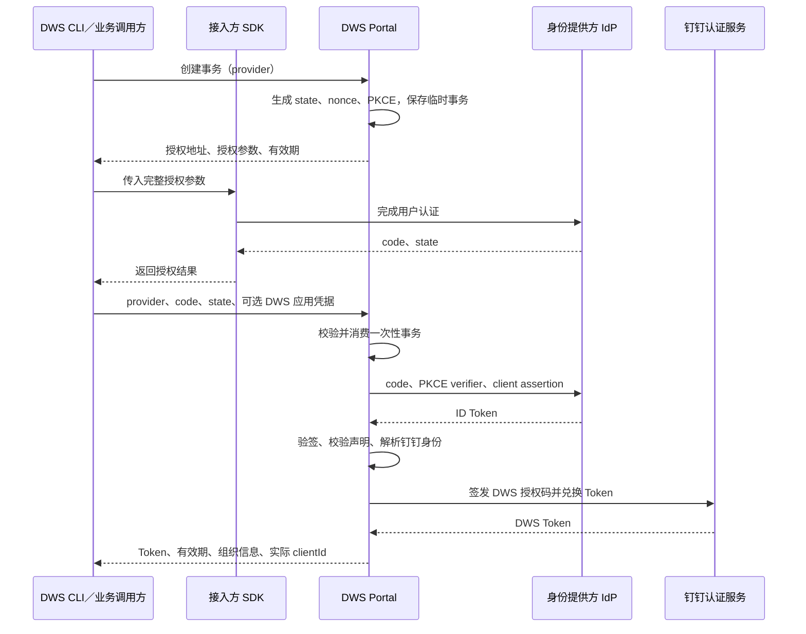

# DWS OIDC 登录变更、后端设计与接口防护

整理日期：2026-10-22。

本文汇总本次第三方 OIDC 登录改造，包含 DWS CLI 变更、Portal 后端设计、新增接口防护及验证范围。

代码依据：

- DWS：`auth_login_provider` 分支，基于 `1c2746729`，包含工作区中三个新增命令的隐藏调整。
- Portal：此前评审的 OIDC 实现提交 `e3f74c097`。整理时后端工作区已切换到委托协议分支，本文未混入该分支的其他改动。
- 描述以代码为准；代码具备相应能力，不代表线上配置已生效或真实 SDK 联调已完成。

## 1. 本次变更概述

本次在 DWS 中增加第三方 OIDC 登录能力：接入方 SDK 完成用户认证，Portal 托管临时事务、校验 OIDC 身份并签发 DWS Token，CLI 复用现有账号与凭证存储体系。

支持两种接入方式：

1. 完整登录：CLI 创建事务、调用接入方 SDK、换票并保存账号。
2. 分步换票：CLI 返回授权参数，由业务方调用 SDK 取得授权码，再交给 CLI 换票；是否保存由调用方决定。

普通 `auth login` 的浏览器登录、设备码登录、手动 Token 登录和登录后授权流程保持原路径。

## 2. DWS CLI 变更

### 2.1 新增命令

| 命令 | 功能 | 本地状态变化 |
|---|---|---|
| `auth provider-login <provider>` | 完整执行创建事务、SDK 登录、换票和保存 | 成功后保存账号并切换默认账号 |
| `auth exchange-prepare --provider <provider>` | 创建事务，返回业务方调用 SDK 所需的授权参数 | 不保存凭证，不切换账号 |
| `auth token-exchange --provider … --code/--code-stdin … --state …` | 使用业务方取得的授权码兑换 DWS Token | 默认只返回 Token；加 `--save` 后在线核验完整身份并保存，保留已有默认账号；首次保存可以成为默认账号 |

三个命令均已设置 `Hidden: true`，从帮助列表和命令名补全中隐藏，且不进入 Schema。同步移除了对应的公开命令 Schema 排除项，避免完整性检查将其判为过期配置。

隐藏只控制命令发现：知道完整名称的调用方仍可直接执行，也可以查看该命令的 `--help`。隐藏不是访问控制，也不关闭后端接口。

### 2.2 SDK 扩展机制

通过 `edition.Hooks.OIDCProviders` 注册接入方 SDK：

- 注册项声明 provider 名称和授权回调；名称须与 Portal 登记的 provider 一致。
- 核心负责创建事务、校验授权参数、换票、身份补全和凭证保存。
- SDK 负责用户认证，原样使用服务端授权参数并返回 `code/state`。
- 注册函数只返回声明；SDK 初始化和认证在实际授权回调中执行。
- SDK 调用受 context 取消和事务有效期约束。
- SDK 会话及密码不写入 DWS 凭证存储；PKCE verifier 和 IdP 应用密钥不传给 SDK。
- 未注册对应 SDK 时明确返回不可用错误，不自动选择其他 provider。

### 2.3 应用凭据与保存

可选的 `--client-id/--client-secret` 必须成对且非空，用于选择本次签发 DWS Token 的应用。

- 不传时，由 Portal 使用服务端托管的 DWS 应用配置。
- 显式传入时使用该应用凭据，失败不降级到默认应用。
- 保存时，密钥进入现有安全凭证槽，并与 Token/Profile 写入一起参与事务和失败回滚。
- 保留密钥原始字节，不在 `app.json`、Token DTO 或结果中输出密钥。
- 不修改全局应用配置，也不替换 IdP 的应用配置。

服务地址使用系统统一的 MCP 配置；新增登录命令本身不修改该配置。

### 2.4 OIDC 刷新隔离

保存的会话记录以下绑定信息：

| 字段 | 用途 |
|---|---|
| `OIDCProvider` | 唯一的 OIDC 会话识别标记 |
| `ClientID` | 实际签发 DWS Token 的应用 ID |
| `MCPBaseURL` | 换票所用的原 Portal 地址 |
| `MCPClientSecretRequired` | 刷新时是否需要读取已保存的自定义应用密钥 |

刷新始终沿用原应用和原 Portal；缺失绑定时明确失败，不使用当前全局应用或其他端点兜底。

OIDC 刷新失败不会读取组织镜像或历史全局凭证来切换应用。网络、取消、超时、限流及 5xx 按临时故障处理；凭证被拒绝或过期时提示重新授权。

旧 Token 不带 `OIDCProvider`，继续走原 MCP/direct 刷新及历史恢复逻辑。

### 2.5 请求与诊断

- OIDC 登录、换票和刷新不额外附加企业凭证头。
- 可选的 DWS 应用密钥仍按对应接口协议传递，与企业凭证头是不同概念。
- 正常协议错误保留公开错误码、操作建议和 trace ID，不透传后端内部 `reason` 或 SDK 原始异常。
- 一次性授权码换票失败或结果不确定时，不自动重试旧 `code/state`，要求重新创建事务并取码。
- `--code-stdin` 支持有界读取和取消；`--dry-run` 不读取授权码、不联网、不保存凭证。

## 3. Portal 后端设计

### 3.1 整体流程



### 3.2 接口分工

| 接口 | 请求要点 | 响应 | 变更性质 |
|---|---|---|---|
| `POST /cli/auth/oidc/transactions` | `provider` | `provider`、`expires_in`、`authorization_request` | 新增 |
| `POST /cli/auth/oidc/exchange` | `provider`、`code`、`state`，可选 `client_id/client_secret` | DWS Token、有效期、组织信息、实际 `clientId` | 新增 |
| `POST /oauth2/refreshToken` | `refreshToken`、`clientId`，可选 `clientSecret` | 刷新后的 Token | 复用既有接口，扩展可选应用密钥 |

创建事务返回 HTTP 201，换票成功返回 HTTP 200。OIDC 换票响应延续现有 Token 字段，并增加实际 DWS `clientId`，供 CLI 绑定后续刷新。

### 3.3 配置管理

`OidcLoginConfigService` 从 Diamond 的 `dws-oidc-login-config` 读取配置，包括：

- 总开关与已登记的 provider。
- provider 对应的组织 `corpId`。
- IdP 的 issuer、授权地址、Token 地址、JWKS 地址。
- IdP 应用 ID、加密后的应用密钥、回调地址、scope 和允许的签名算法。
- 加密后的 state HMAC 签名密钥。

客户端选择 provider；上游 Token/JWKS 地址、IdP 应用和目标组织由服务端配置决定。配置无法解析或相关必要配置缺失时，流程返回错误。

IdP 应用和 DWS 应用各有独立职责：前者用于验证接入方身份，后者用于签发最终 DWS Token。CLI 的可选应用凭据只作用于后者。

### 3.4 临时事务

`OidcLoginService` 生成随机 state、nonce 和 PKCE verifier，并为 state 加上有效期与 HMAC 签名。

事务记录包含 state 摘要、provider、nonce、verifier 和过期时间。`TairOidcTransactionStore` 将事务经 KeyCenter 加密后写入 Tair，有效期为 10 分钟。

换票时先校验 state，再读取并删除事务；只有获得成功删除结果的请求才能继续。事务在上游请求之前消费，后续失败不会恢复旧事务。

### 3.5 上游换票与身份校验

`OidcTokenClient` 使用配置中的 IdP 密钥生成 `client_secret_jwt`，连同授权码和 PKCE verifier 向 IdP 换票。

Client assertion 使用 HS256，包含 `iss/sub`、目标 Token endpoint、签发和过期时间以及随机 `jti`，有效期 60 秒。IdP 侧仍需验证 assertion 并执行相应的防重放策略。

取得 ID Token 后，Portal 使用配置中的 JWKS 验证签名和声明。当前身份接入约定为：**ID Token 的 `sub` 表示钉钉组织内的 userId/staffId**。

`DwsOidcSessionProvider` 结合 provider 配置中的 `corpId`，通过组织员工映射查询得到 uid；查询失败则停止签发。客户端不直接指定用于签发的 uid 或目标组织。

### 3.6 DWS 会话签发与刷新

`DwsOidcSessionProvider` 调用 `QwenWorkAuthHsfService.issueCliAuthCode`，再通过 `CliOAuthService` 将授权码兑换为 DWS Token。Token 经现有 KeyCenter 路径加密后返回。

不传 DWS 应用凭据时使用托管配置；显式传入时使用该凭据，不静默降级。后续刷新复用 `/oauth2/refreshToken`：无 `clientSecret` 时走托管凭据查找，有 `clientSecret` 时使用成对的显式应用凭据。

## 4. 新增接口防护

本节覆盖 `/cli/auth/oidc/transactions` 和 `/cli/auth/oidc/exchange`。它们允许未登录客户端发起，身份认证依靠后续 OIDC 校验和钉钉身份映射，不要求企业凭证头。

| 防护层 | 当前实现 | 作用 |
|---|---|---|
| Provider 准入 | 仅接受服务端配置中已登记、启用的 provider；换票 provider 必须与事务一致 | 拒绝任意身份源和跨 provider 换票 |
| 请求规模 | 仅接受 POST JSON；拒绝 query 参数；请求体最多 16 KiB，同时限制声明长度和实际读取长度 | 限制输入规模，避免凭证通过 URL 传递 |
| JSON 结构 | 仅允许约定的平面字符串字段；拒绝重复、未知、嵌套、空白字段及尾随 JSON；应用 ID、密钥必须成对 | 避免解析歧义和非法参数进入业务层 |
| state 防伪 | 随机值、有效期及 HMAC-SHA256 签名；在访问 Tair 前校验，签名使用常量时间比较 | 提前拦截伪造、篡改和过期事务 |
| 事务防重放 | 事务有效期 10 分钟；经 KeyCenter 加密存入 Tair；只有成功删除事务的请求才能继续 | 同一事务并发调用时最多一个请求进入上游换票 |
| 授权码绑定 | 使用 PKCE S256，verifier 仅保存在后端；校验 ID Token 中的 nonce | 将授权结果绑定到本次登录事务 |
| ID Token 校验 | 校验签名、算法、iss、aud/azp、nonce、sub、exp/iat/nbf；拒绝 Token 自带远程密钥地址等不受信任的密钥来源 | 拒绝伪造身份、错误受众及不符合时间窗口的 Token |
| 身份与组织绑定 | 组织取自 provider 配置；验证后的 sub 查询组织员工映射，获得 uid 后才签发 DWS Token | 避免客户端直接指定目标 uid 或组织来取得凭证 |
| 分阶段限流 | 创建事务、换票分别按 provider 接入 Sentinel；先确认 provider 已登记，再构造限流资源名 | 分别保护事务存储与上游认证服务，限制限流资源集合规模 |
| 上游请求目标 | 使用配置中的 HTTPS 地址，并调用统一 SSRF 校验 | 限制外发请求目标；实际地址准入受统一安全策略约束 |
| 上游 HTTP 行为 | 禁止重定向、自动重试、Cookie、自动认证和响应解压 | 限制凭证转发和隐式请求行为，避免重复消费授权码 |
| 超时控制 | 连接获取和连接超时均为 3 秒，读取超时 5 秒，每次外发请求 15 秒主动中止 | 限制慢响应对资源的占用 |
| 响应边界 | Token 响应最多 64 KiB，JWKS 最多 256 KiB，ID Token 最多 32 KiB；JSON 深度最多 32 层、解析 token 数最多 10000 | 限制大响应和复杂 JSON 的解析成本 |
| 错误与缓存 | 返回公开错误码、固定文案、action、trace ID；内部 reason 不返回；响应设置 no-store | 支持诊断，减少异常回显和凭证缓存 |

### 4.1 限流的实际边界

当前代码接入的 Sentinel 资源为：

```text
dws:oidc:provider:create:<provider>
dws:oidc:provider:exchange:<provider>
```

- 实际阈值和是否生效依赖部署的 Sentinel 规则；仅有接入代码不能证明线上限流已经启用。
- 命中限流返回 HTTP 429。
- Sentinel 自身发生运行异常时，当前代码选择放行。
- 配置中保留了 `perPeerPerMinute` 和 `globalPerMinute`，但该版本未看到它们接入请求拦截逻辑，不能表述为已经实现每 IP 或全局限流。
- 网关侧是否配置了额外限流规则，本次未核实。

### 4.2 防护适用范围

上述 16 KiB 请求限制、平面 JSON 校验、state 和一次性事务机制针对两个新增 OIDC 接口。

`/oauth2/refreshToken` 是既有接口扩展，不自动具备上述新增接口的全部防护。它仍有历史上游错误文案透传逻辑；DWS 新增的 OIDC 刷新路径会丢弃该原始文案并输出固定错误。

## 5. 影响面与评审结论

目前未发现本次 OIDC 改动导致原有登录功能回归。主要隔离边界为：

- 普通登录仍走原浏览器、设备码和手动 Token 分支。
- 新增 SDK 只在 provider 登录流程中调用。
- 只有非空 `OIDCProvider` 才触发新的刷新规则；旧 Token 保持原策略。
- 普通凭证保存路径保持原行为；自定义应用密钥新增事务保存能力。
- 显式执行新的 `provider-login` 并成功保存后，会按登录语义切换默认账号；分步 `token-exchange --save` 保留已有默认账号。

此前 CR 项的处理结论：

| 项目 | 结论 |
|---|---|
| OIDC 请求未加企业凭证头 | 按已确认接口契约无需添加，不作为缺陷 |
| 默认应用登录在身份补全阶段取消后仍可能保存 | 根因已存在于原登录路径，本次不修改 |
| 畸形 HTTP 响应可能绕过客户端脱敏 | 人工构造响应可以验证边界问题，但未找到当前后端实际生成该响应的路径，不作为已确认的实际泄露问题 |
| 切换 Portal 配置后退出旧账号的远程撤销 | 原 MCP 退出路径仍使用当前全局地址，属于历史限制，本次未修改 |

## 6. 验证与交付状态

本轮已完成的相关验证包括：

- 认证包全量测试，以及登录、刷新、换票和凭证隔离相关定向测试。
- 输出与 edition 相关测试，以及相关静态检查。
- 三个命令隐藏后的 ProviderLogin、SplitOIDC 和 Schema 完整性测试。
- 标准 `make build`。
- 构建后二进制的 `auth --help`、Bash 补全及隐藏命令直接查看帮助的检查。

验证结果：三个新命令不出现在帮助列表和 Bash 命令补全中，仍可显式调用；普通 `auth login` 保持可见。

本轮未执行真实 SDK 与后端的端到端登录联调，也未验证线上 Sentinel 或网关规则。整理时，三个命令隐藏调整仍在工作区，尚未提交。

## 7. 主要代码索引

DWS：

- `internal/app/auth_provider_login.go`：完整 provider 登录入口。
- `internal/app/auth_oidc_exchange.go`：分步准备与换票命令。
- `internal/app/auth_provider_hooks.go`、`pkg/edition/oidc.go`：SDK 扩展接口与适配。
- `internal/auth/oidc_provider.go`：事务调用、授权参数校验和换票。
- `internal/auth/oidc_exchange.go`：分步换票、身份核验与保存。
- `internal/auth/oidc_refresh.go`、`internal/auth/oauth_helpers.go`：OIDC 刷新绑定和分流。
- `internal/cli/schema_command_exclusions.go`：公开命令的 Schema 排除项管理。

Portal（以 `e3f74c097` 中的文件为准）：

- `start/src/main/java/com/dingtalk/open/mcp/portal/http/CliOidcController.java`：新增接口、输入校验和错误输出。
- `service/src/main/java/com/dingtalk/open/mcp/portal/service/oauth/oidc/OidcLoginConfigService.java`：provider 配置与 state 签名密钥。
- `service/src/main/java/com/dingtalk/open/mcp/portal/service/oauth/oidc/transaction/OidcLoginService.java`：事务、state 验证及 Sentinel 接入。
- `service/src/main/java/com/dingtalk/open/mcp/portal/service/oauth/oidc/transaction/TairOidcTransactionStore.java`：加密事务存储和一次性消费。
- `service/src/main/java/com/dingtalk/open/mcp/portal/service/oauth/oidc/provider/OidcTokenClient.java`：IdP 换票、ID Token 验证及外发请求防护。
- `service/src/main/java/com/dingtalk/open/mcp/portal/service/oauth/DwsOidcSessionProvider.java`：组织身份映射及 DWS 会话签发。
- `service/src/main/java/com/dingtalk/open/mcp/portal/service/oauth/CliOAuthService.java`：现有 DWS Token 兑换与刷新。
