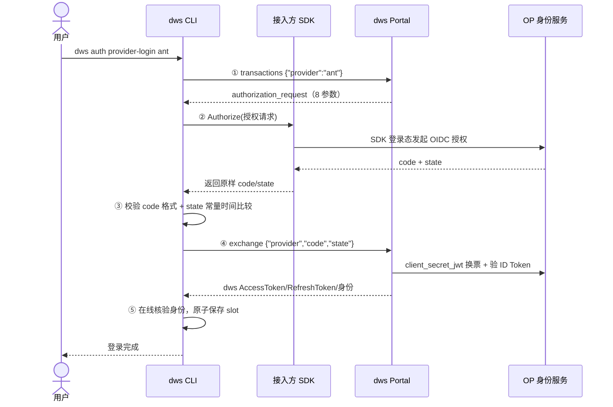
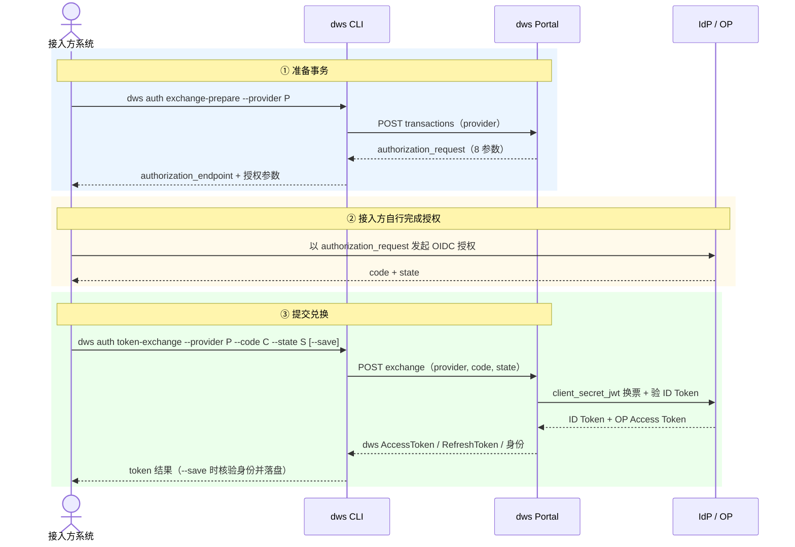
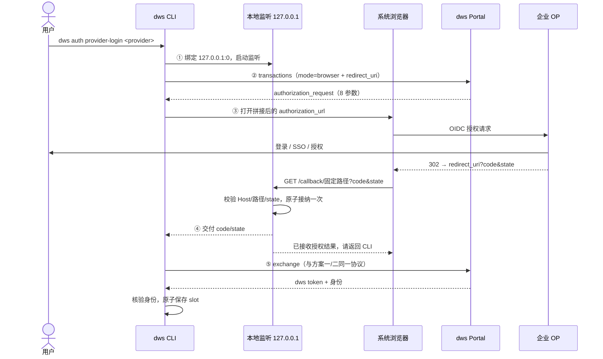
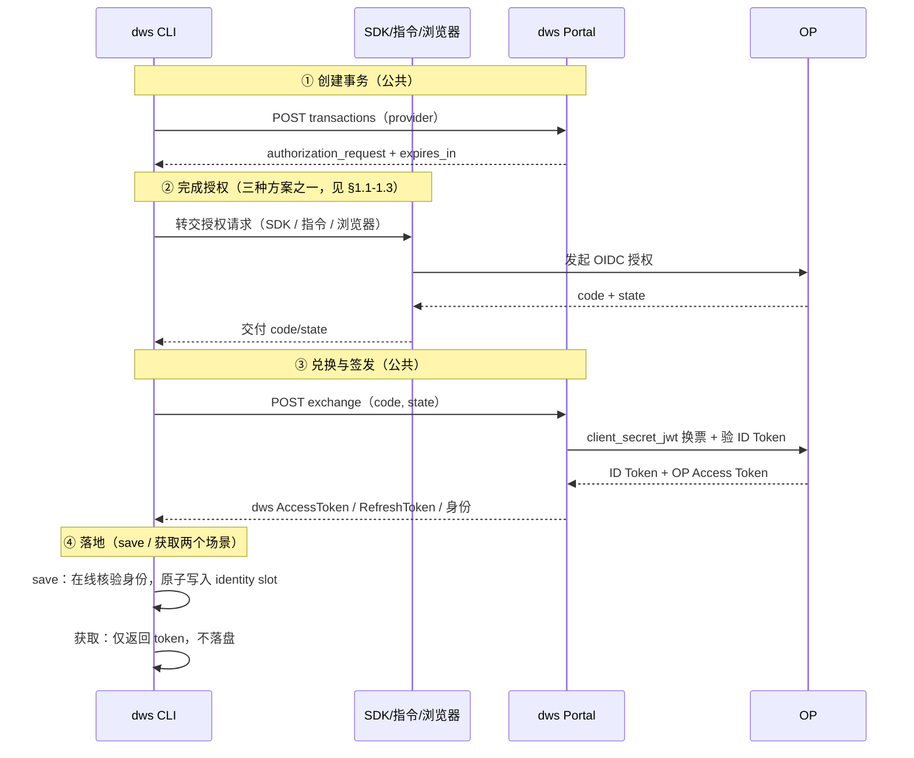

# DWS OIDC 登录方案设计

> 版本：2026-10-19。状态标注：✅ 已实现 ｜ 🕐 暂未实现（设计稿）。后端契约以 portal 仓库联调为准。
> 符号约定：S = state，N = nonce，V = code_verifier，H = code_challenge，C = code（仅为说明符号，非协议字段）。

## 1. 交互方案

DWS 支持三种 OIDC 交互方案，差异只在「谁完成授权、code 如何回到 CLI」，后端协议与凭证落地完全相同。

| 方案 | 交互方式 | 状态 |
| --- | --- | --- |
| 方案一：SDK 授权（蚂蚁） | 接入方 SDK 完成登录并回传 code/state，CLI 全程托管 | ✅ |
| 方案二：指令对接（exchange-prepare / token-exchange） | 接入方自行调用 IdP/SDK 拿 code，通过两条指令与 CLI 分步交互 | ✅ |
| 方案三：企业 OP 浏览器模式（loopback 本地回调） | CLI 起本地监听 + 系统浏览器，OP 302 回调回传 code | 🕐 |

### 1.1 方案一：SDK 授权（蚂蚁）✅

CLI 创建事务后，把服务端签发的授权请求整体交给注册的 SDK；SDK 用自己的登录态完成授权，返回 code/state；CLI 校验后兑换并保存。



### 1.2 方案二：指令对接（exchange-prepare / token-exchange）✅

面向「接入方自己完成授权」的编排场景：先创建事务拿到授权参数，接入方在自己的系统里完成授权拿到 code，再通过指令提交兑换。



### 1.3 方案三：企业 OP 浏览器模式（loopback 本地回调）🕐

设计稿，当前未实现：CLI 先绑定 loopback 随机端口，把实际回调地址交给后端登记进事务，再打开系统浏览器访问 OP 授权页，OP 302 重定向回本地回调，CLI 收 code/state 后走同一兑换链路。



## 2. 支持的能力

### 2.1 OAuth/OIDC 换取 dws token ✅

- CLI 与 Portal 之间只有两个接口：`POST /cli/auth/oidc/transactions`（创建事务）与 `POST /cli/auth/oidc/exchange`（兑换）。
- 后端托管 state/nonce/PKCE 与 OP 应用密钥；CLI 不接触 verifier 与 client_secret，兑换只提交 `{code, state}`。
- 兑换成功返回 dws AccessToken + RefreshToken + 权威身份（corpId/userId），并在线核验后才可使用。

### 2.2 dws token 的 slot 存储 ✅

keychain 中共三个凭据槽位，OIDC 登录写入**精确身份槽**：

| 槽位 | account 名 | 用途 |
| --- | --- | --- |
| legacy/global | `auth-token` | 旧式全局槽，OIDC 不使用 |
| corp/org | `auth-token:<corpId>` | 组织级槽 |
| identity | `auth-token:id:<sha256(corpId+"\0"+userID)>` | **OIDC 登录落点**：按 corp+user 精确键 |

- 保存是**原子的**：profiles 锁内完成「写前检查 → 写 token → 写 Profile 默认指向」，失败保留旧 Profile，不产生半写状态。
- 携带 `--client-id/--client-secret` 时，应用 secret 单独写入应用凭据槽（不影响全局应用配置）。
- SDK 会话（如 sdk_session_token）**永不落盘**。

### 2.3 refresh token 续期 ✅

- 兑换返回的 RefreshToken 与 AccessToken 一起原子保存；`Source="mcp"` 的凭证进入托管刷新分支。
- 登录保存 `oidc_provider` 作为唯一 OIDC 来源标识；Portal 地址和密钥模式不用于推断登录类型。未记录来源的开发测试凭证需重新登录，不做兼容迁移；该元数据不改变未保存的换票返回值。
- 刷新只使用当前凭证绑定的应用、密钥和 Portal，绑定缺失直接失败，不读取组织镜像或历史凭证恢复。
- 刷新成功返回新凭证组合时**原子替换**旧值；凭证到期或明确被拒绝则重新执行原登录流程。网络异常、取消、超时、限流和 5xx 保留凭证，允许稍后重试。
- SDK 退出、OP 浏览器退出、ID Token 到期不会自动撤销 dws 会话。

### 2.4 save 与获取生成 dws token 的两个场景 ✅

| 场景 | 命令 | 行为 |
| --- | --- | --- |
| 获取（不落盘） | `auth token-exchange`（不带 `--save`） | 仅换取 dws token 并返回给调用方，**不写入本地 slot**，供外部编排继续使用 |
| 保存（落盘） | `auth provider-login` ｜ `auth token-exchange --save` | 在线核验 token 与身份一致后，原子写入精确身份槽并切换默认 Profile |

## 3. 交互协议

### 3.1 OIDC 交互完整流程

三种方案合流后的完整流程（①-③ 为交互差异点，④ 起为公共协议）：



### 3.2 提供的协议接口

后端共暴露三个接口（前两个已实现，cancel 为设计稿）。所有请求零重试（code 一次性消费）；CLI API 为 JSON + snake_case 请求；响应经 MCP 网关为 camelCase。

| 接口 | 用途 | 成功响应 | 状态 |
| --- | --- | --- | --- |
| `POST /cli/auth/oidc/transactions` | 创建授权事务 | 201 | ✅ |
| `POST /cli/auth/oidc/exchange` | 提交 code/state 兑换 dws token | 200 | ✅ |
| `POST /cli/auth/oidc/cancel` | 取消事务 | 204 / 202 | 🕐 设计稿 |

#### 3.2.1 transactions：创建授权事务 ✅

请求（当前实现只发送 provider）：

```json
POST /cli/auth/oidc/transactions
{ "provider": "ant" }
```

成功 201（status 必须为 authorizing，expires_in ∈ (0, 600]）：

```json
{
  "status": "authorizing",
  "expires_in": 600,
  "authorization_request": {
    "authorization_endpoint": "https://op.example.com/oauth2/authorize",
    "parameters": {
      "client_id": "<OP 登记的 dws 应用>",
      "response_type": "code",
      "scope": "openid <...>",
      "redirect_uri": "<后端固定回调地址>",
      "state": "<43B base64url>",
      "nonce": "<43B base64url>",
      "code_challenge": "<43B base64url>",
      "code_challenge_method": "S256"
    }
  }
}
```

- `code_verifier` **不在响应中**，仅后端保存。
- 后端同时登记事务、生成 S/N/V/H、锁定 provider 配置快照。

#### 3.2.2 exchange：兑换 dws token ✅

请求（provider 必填；client_id/client_secret 可选但须成对，为 DWS 应用凭据）：

```json
POST /cli/auth/oidc/exchange
{ "provider": "ant", "code": "<C>", "state": "<S>", "client_id": "<可选>", "client_secret": "<可选>" }
```

成功 200（MCP 网关 camelCase；clientId 必须与请求凭据一致）：

```json
{
  "accessToken": "<dws AccessToken>",
  "refreshToken": "<dws RefreshToken>",
  "expiresIn": 7200,
  "corpId": "<权威身份>",
  "corpName": "<组织名>",
  "clientId": "<与请求凭据一致>"
}
```

后端步骤：state 匹配事务 → client_secret_jwt 向 OP 换票 → 验 ID Token（签/iss/aud/nonce）→ (iss,sub) 映射身份 → 幂等签发 dws 会话。

#### 3.2.3 cancel：取消事务 🕐 设计稿

```json
POST /cli/auth/oidc/cancel
{ "state": "<S>" }
```

- 204：同步取消成功（事务尚未进入换票阶段）；
- 202：异步取消受理（status=processing + action=retry_same_request；当前 CLI 零重试，收到即失败）。

#### 3.2.4 状态码与错误协议

| 状态码 | 语义 |
| --- | --- |
| 200 | 兑换成功 |
| 201 | 事务创建成功 |
| 202 | 异步处理中（设计稿；CLI 零重试，直接失败） |
| 204 | 取消成功 |
| 400 | 参数无效（invalid_grant / invalid_state） |
| 401 | 未认证（应用凭据对无效） |
| 404 | transaction_not_found / provider_unavailable |
| 409 | 事务冲突（如 token_already_issued、code 已消费） |
| 429 / 503 | 限流 / 暂不可用（temporarily_unavailable）；CLI 不重试 |

错误响应（设计稿格式，统一 JSON）：

```json
{
  "error": { "code": "identity_not_mapped", "message": "<用户友好文案>", "action": "stop" },
  "trace_id": "<非敏感>"
}
```

| 错误码 | action | 含义 | CLI 归类 |
| --- | --- | --- | --- |
| unsupported_provider / provider_unavailable / temporarily_unavailable | stop | 后端未配置或暂不可用该 provider | `OIDC_PROVIDER_UNAVAILABLE` |
| identity_not_mapped | stop | (iss,sub) 无法映射到 corp/user | 业务失败 |
| invalid_grant / invalid_state | restart_login | code/state 不匹配或已消费 | 提示重新登录，不重用旧 code |
| token_already_issued | stop | 事务已签发过会话 | 幂等冲突 |

`action` 三值：`stop`（修正配置/权限后停止）、`restart_login`（重新登录，不重用旧 code）、`retry_same_request`（设计稿；当前 CLI 零重试）。

#### 3.2.5 事务状态机（设计稿）

```text
created → authorizing ──提交 code──→ exchanging → issued（幂等：同 C/S 复用结果）
   │            │                          │
   │            └─cancel 204──→ cancelled   ├─cancel 202（processing，异步受理）
   └─expires_in 超时（≤600s）→ expired      └─不同 code 同 state → 409 冲突
```

### 3.3 接口定义的协议格式（参数字典）

**transactions 请求**（当前实现只发送 provider）：

| 参数 | 要求 | 说明 |
| --- | --- | --- |
| provider | 必填，`[a-z][a-z0-9_-]{0,63}` | 后端受信配置键；非任意 URL |
| interaction_mode | 设计稿字段，未实现 | sdk ｜ browser |

**transactions 响应（authorization_request.parameters，恰好 8 字段）**：

| 参数 | 值 / 约束 |
| --- | --- |
| client_id | OP 登记的 dws OIDC 应用；≤512B |
| response_type | 固定 `code` |
| scope | 至少含 `openid`；≤2048B |
| redirect_uri | 后端固定的回调地址；IsAbs、无 userinfo/fragment；≤2048B |
| state / nonce / code_challenge | 43 字符 base64url 随机值；state ≤1024B |
| code_challenge_method | 固定字符串 `S256` |
| expires_in | (0, 600] 秒，首次提交 code 的窗口 |
| code_verifier | **不返回**，仅后端保存 |

**exchange 请求**：

| 参数 | 约束 |
| --- | --- |
| provider | 两个 CLI 入口均必填并透传，须与事务绑定的身份源一致；HTTP 接口允许旧客户端省略 |
| code | 非空 ≤8192B，无控制字符 |
| state | 非空 ≤1024B，无空白；与事务 state 一致 |
| client_id / client_secret | 可选，须成对；DWS 应用凭据（与 OP client 注册分离） |

**exchange 成功响应（MCP 网关 camelCase）**：`accessToken`、`refreshToken`、`expiresIn`、`corpId`、`corpName`、`clientId` 等；`clientId` 必须与请求凭据一致。

**错误响应**（设计稿格式）：

```json
{
  "error": { "code": "identity_not_mapped", "message": "…", "action": "stop" },
  "trace_id": "<non-secret>"
}
```

action 三种：`stop`（修正配置/权限后停止）、`restart_login`（重新登录，不重用旧 code）、`retry_same_request`（设计稿；当前 CLI 零重试）。

### 3.4 公共的协议

三种方案共用的部分（与交互方式无关）：

| 公共协议 | 内容 |
| --- | --- |
| 统一授权请求 | authorization_request：`authorization_endpoint` + 8 参数字段；SDK 直接消费，浏览器模式由 CLI 编码拼接，指令模式输出给接入方 |
| 后端换票 | `POST token_endpoint`，client_secret_jwt：`grant_type=authorization_code + code + client_id + client_assertion_type + client_assertion + redirect_uri + code_verifier`（完整协议见 §3.4.1） |
| ID Token 验证 | 受信 JWKS 验签 + 算法白名单；iss/aud(azp)/exp/iat/sub/nonce 全量校验；`(iss,sub)` → corpId/userId 权威映射 |
| 幂等签发 | 一个事务一次换票、一个 dws 会话；同一 C/S 复用结果，不同 code 同 state 冲突 |
| 零重试 | CLI 对门户请求一律单次发送 |
| 错误分类 | 取消原样透传；超时 `NETWORK_TIMEOUT`；连接失败 `NETWORK_UNREACHABLE`；未配置 provider `OIDC_PROVIDER_UNAVAILABLE`；未集成 SDK `OIDC_SDK_UNAVAILABLE` |
| 安全校验 | 响应 ≤64KB + 拒绝重复 JSON key + 禁止重定向；state 常量时间比较；日志剥离 query/fragment、不落 SDK 错误正文 |

#### 3.4.1 后端换票接口（Portal → OP Token Endpoint）✅

调用方是 **dws Portal（后端机密客户端）**，接口是 OP 的标准 OIDC Token Endpoint，认证方式固定 client_secret_jwt。CLI 不参与此调用。

请求（application/x-www-form-urlencoded）：

```text
POST <token_endpoint>
Content-Type: application/x-www-form-urlencoded

grant_type=authorization_code
&code=<授权码 C>
&client_id=<OP 登记的 dws 应用 ID>
&client_assertion_type=urn:ietf:params:oauth:client-assertion-type:jwt-bearer
&client_assertion=<Portal使用OP共享密钥签名的HS256 JWT>
&redirect_uri=<与授权请求中的 redirect_uri 完全一致>
&code_verifier=<PKCE verifier V，事务创建时后端生成并保存>
```

客户端认证 JWT：`iss=sub=client_id`、`aud=token_endpoint`、`iat=当前时间`、`exp=iat+60秒`、`jti=每次新UUID`。共享 secret 沿用 KeyCenter 密文配置，解密后以原始 UTF-8 字节参与 HS256，至少 32 字节；不发送 secret，不回退到 secret_post。IdP 校验签名、声明、期限并原子拒绝 jti 重放。`client_assertion` 是 Portal 的客户端认证证明，返回的 ID Token 仍使用下述非对称算法验签。实际表单需编码字段值。

成功响应（200）：

```json
{
  "access_token": "<OP AccessToken>",
  "refresh_token": "<OP RefreshToken（可选）>",
  "id_token": "<JWT>",
  "token_type": "Bearer",
  "expires_in": 3600,
  "scope": "openid <...>"
}
```

ID Token 验证（Portal 全量校验，任一失败即拒绝并归 restart_login）：

| 校验项 | 要求 |
| --- | --- |
| 签名 | 受信 JWKS 验签；算法白名单，禁 none/HS* |
| iss | 受信 OP 签发者 |
| aud / azp | 必须含本应用的 client_id |
| exp / iat | 未过期且时间窗合理 |
| sub | 非空 |
| nonce | 与事务保存的 nonce 一致 |

身份映射与签发：

- `(iss, sub)` → corpId/userId 权威映射；映射失败返回 `identity_not_mapped`（action=stop）。
- 幂等：一个事务只签发一个 dws 会话；同一 code/state 复用结果。
- code 一次性：OP 已消费 code 后 Portal 不得重复提交；OP 返回 invalid_grant 时转 `restart_login`。

约束：

- OP 密钥仅后端持有，不进入 CLI、日志、错误文案。
- 换票请求与 CLI 一样零重试（code 一次性消费）。
- 响应体 64KB 上限；JSON 重复 key 拒绝。

错误转译：OP 返回 invalid_grant（code 已消费/过期）→ Portal 转 `restart_login`；OP 不可用或超时 → `temporarily_unavailable`（action=stop）。

## 4. 对接方式

### 4.1 方案一如何对接（SDK 授权）✅

接入方只需实现并注册一个授权函数，其余（事务、校验、兑换、保存）全部由 CLI 骨架完成：

1. **Portal 登记**：为该 provider 配置 OIDC 客户端（授权端点、redirect 绑定、token 端点、client_secret_jwt、账号映射）。
2. **实现 Authorize**（契约八条）：
   - 调用时机：后端接受 provider 且核心校验完授权请求后才被调用；
   - 参数原样保留（client_id/redirect_uri/state/nonce/code_challenge/S256 不得改写）；
   - 校验 AuthorizationEndpoint 与预期一致（防换端点）；
   - 返回 SDK 收到的 code/state **原样**；
   - honor ctx 取消与 deadline（上限为事务 expires_in ≤600s）；
   - 错误不携带 SDK 凭据/授权码；永不回退其他 provider；
   - SDK 会话不落盘、不带入 exchange。
3. **注册**：经 `edition.Hooks.OIDCProviders` 注册 `{Name, Authorize}`；Name 匹配 `[a-z][a-z0-9_-]{0,63}` 且与 Portal 一致；未注册即报 `OIDC_SDK_UNAVAILABLE`，无需空实现。
4. **测试**：命名保持 `TestCrossPlatformCoverage*` 前缀；参考 `auth_provider_hooks_test.go`（成功 / 失败不 exchange / 取消超时 / 未注册 / 无效注册五类场景）。

> 已知事实：钉钉 `/oauth2/auth` 支持 `state`（推荐参数，回调 `?authCode&state` 原样回显）；DWS 的钉钉原生授权链接（`buildAuthURLForRegion`，即 `dws auth login` 遗留流程）不下发 `state`，因此回调 `/dingtalk/callback`（示例 `docs/examples/dingtalk-oauth-callback`）只收到 `authCode`，该流程依赖 loopback 监听与一次性 authCode。本方案的 state 由 Portal 事务下发，走 SDK/IdP 授权链路；CLI 侧的 state 常量时间校验不变。

### 4.2 方案二如何对接（指令对接）✅

接入方在自己的系统内完成授权，通过两条指令与 CLI 分步交互：

```bash
# ① 创建事务，输出授权参数
dws auth exchange-prepare --provider <p>
#  → authorization_endpoint + 8 参数字段（state 必须原样保留）

# ② 接入方自行调用 IdP/SDK 完成授权，取得 code

# ③ 提交兑换（--code 与 --code-stdin 二选一，--state 必填）
dws auth token-exchange --provider <p> --code <C> --state <S>          # 仅获取 token
dws auth token-exchange --provider <p> --code <C> --state <S> --save   # 核验身份并落盘
```

约束：

- exchange-prepare **拒绝应用凭据**；`--client-id/--client-secret` 只允许出现在 token-exchange 侧且必须成对。
- state 必须来自本次事务并原样回传；code 失败后不得重试旧 code（提示重新 prepare）。
- `--save` 才做在线身份核验与持久化；不带 `--save` 时 token 不落盘。
- `--code/--state` 在遥测 argv 中自动脱敏。
- 与隐藏命令 `auth exchange --code`（OAuth 直连/MCP 模式）是**不同命令面**，不可混用。

### 4.3 方案三如何对接（浏览器模式）🕐

设计稿，尚未实现。预期对接要点：

1. **OP 登记前提**：企业 OP 须支持「原生应用 loopback 随机端口回调 + 后端机密组件换票」组合登记（RFC 8252 §7.3 不能单独证明其支持）。
2. **本地监听规则**：先绑定 127.0.0.1:0 再创建事务（不探测后重绑）；仅 loopback IP；固定回调路径 `/callback/<provider>`；GET/query 响应模式；首个合法结果原子接纳一次；错误 state 不消费不结束等待。
3. **回调页安全**：no-store / no-referrer / CSP frame-ancestors 'none'；文案不含 code/state/token。
4. **不覆盖场景**：远程 SSH 主机运行 CLI + 异地浏览器的跨机器登录不在本版路径内。
