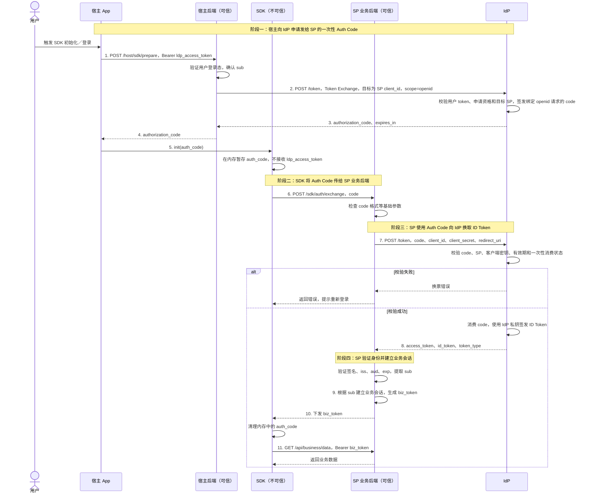

# 三方 SDK 免登协议与遗留问题

> 历史方案参考（2026-10-15）：本文保留早期讨论内容。当前已实现的 OIDC 接入以相邻 portal 仓库的 [协议与联调说明](../../lippi-openmcp-portal/docs/dws-oidc-backend.md) 和 [OpenAPI](../../lippi-openmcp-portal/docs/dws-oidc-openapi.json) 为准；当前 ant 流程先用 transactions 检查配置，成功后由 SDK 直接返回 code/state，再调用 exchange；已移除 ant 浏览器授权与本地回调。本期不包含旧稿中的 interaction_mode、取消或会话恢复接口。

日期：2026-10-15。状态：按原截图整理的协议方案，尚未实现或联调。

本方案沿用截图中的参与方、四个阶段和接口，参数按本次讨论确定。宿主为指定 SP 申请一次性 authCode，经 SDK 转交 SP；SP 使用自己的客户端密钥向 IdP 换取身份，建立业务会话。成功登录默认全部业务权限。

## 1. 参与方

| 参与方 | 职责 |
| --- | --- |
| 宿主 App | 触发登录，通过宿主后端获取 authCode，初始化 SDK |
| 宿主后端（可信） | 使用当前用户的 IdP access token，为指定 SP 申请 authCode |
| SDK（客户端，不可信） | 接收并暂存 authCode，向 SP 兑换 biz_token，调用业务接口 |
| SP 业务后端（可信） | 使用 client_id/client_secret 换票，验证身份并建立业务会话 |
| IdP（截图中的 LDP） | 验证用户登录态，签发一次性 authCode，向 SP 返回 ID Token |

## 2. 完整时序



## 3. 四阶段接口说明

### 阶段一：宿主申请发给 SP 的一次性 authCode

宿主 App 请求宿主后端：

```http
POST /host/sdk/prepare
Authorization: Bearer <ldp_access_token>
```

宿主后端确认用户登录态，向 IdP 发起第一次 Token Exchange。沿用截图中的发码方式，增加必传的 `scope=openid`，明确请求用户身份认证，供后续换票获取 ID Token。实际协议兼容性列在遗留事项中：

```text
POST /token

grant_type=urn:ietf:params:oauth:grant-type:token-exchange
subject_token=<ldp_access_token>
subject_token_type=access_token
audience=<biz_server_client_id>
requested_token_type=code
scope=openid
```

`audience` 就是目标 SP 的 client_id，表示申请发给该 SP 的 code。申请阶段按有效用户 token 与该 SP 的既定接入规则校验，不额外引入独立的宿主 client_id/client_secret。

`scope=openid` 用于身份认证，不表示选择具体业务权限；业务侧仍按登录成功默认全部权限处理。IdP 须将这次身份认证请求与签发的 code 关联，确保后续合法兑换返回 `id_token`。本接口不接受缺失 `openid` 后退化为仅获取 Access Token 的登录流程。

这里的关联和签发规则是本方案对 IdP 发码扩展的明确约定，不能仅凭增加 `scope=openid` 就认定 Token Exchange 自动支持 OIDC 发码。标准授权端点的请求使用 `response_type=code` 和 `scope=openid`；本方案仍使用截图中的 Token Exchange 接口，不在该接口混入 `response_type`。[OIDC 授权请求定义](https://openid.net/specs/openid-connect-core-1_0.html#AuthRequest)

IdP 检查：

1. 用户 access token 合法且未过期。
2. 该申请符合为此用户获取目标 SP 登录票据的规则。
3. 目标 SP client_id 合法。
4. scope 包含 openid，且支持本方案的身份认证与换票约定。
5. 生成一次性 authorization_code，绑定用户身份、目标 SP 和本次 openid 请求，设置有效期。

IdP 返回 authorization_code 和 expires_in；原图建议短期有效，约 60 秒至 5 分钟，具体由 IdP 约定。宿主后端将 code 返回宿主 App，再由宿主调用：

```text
SDK.init(auth_code)
```

SDK 暂存 authCode，此时不接收宿主的 IdP access token。

### 阶段二：SDK 将 authCode 交给 SP

```http
POST /sdk/auth/exchange
Content-Type: application/json
```

```json
{
  "code": "<authorization_code>"
}
```

SP 检查 code 格式等基础参数，然后进入服务端换票。

### 阶段三：SP 向 IdP 换取身份

SP 使用自己的 client_id/client_secret 请求 IdP。密钥仅保存在 SP 后端：

```text
POST /token

grant_type=authorization_code
code=<authorization_code>
client_id=<biz_server_client_id>
client_secret=<biz_server_secret>
redirect_uri=<双方约定的取值，原图允许约定 URL 或空>
```

换票的 `grant_type` 保持 `authorization_code`，不改成 `id_token`；`openid` 已在申请 code 时确定，不在此阶段临时补充来改变 code 的用途。

IdP 检查 code 存在且未过期、绑定的 SP 与当前 client_id 一致、client_secret 正确，以及 code 未被消费。校验通过后将 code 标记为已消费，并使用 IdP 私钥签发 ID Token。一次性检查与消费需原子完成，避免并发重复使用。

成功响应沿用原图：

```json
{
  "access_token": "<idp_access_token_for_sp>",
  "id_token": "<signed_id_token>",
  "token_type": "Bearer"
}
```

SP 只需要身份信息时，读取并验证 `id_token` 即可，`access_token` 可以不使用。本方案不增加“只返回 ID Token”的换票参数；标准 OIDC 授权码成功响应包含 ID Token 和 Access Token。[OIDC 成功响应定义](https://openid.net/specs/openid-connect-core-1_0.html#TokenResponse)

换票失败时，SP 向 SDK 返回错误，SDK 提示重新登录。具体错误码由 IdP 接口契约确定。

### 阶段四：SP 验证身份并建立会话

SP 对返回的 ID Token 执行原图中的校验：

1. 通过可信 IdP JWKS 验证签名。
2. iss 为约定的 IdP issuer。
3. aud 为目标 SP 的 biz_server_client_id。
4. exp 未过期。
5. 提取已验证的用户标识 sub。

SP 根据已验证的 sub 建立该用户的业务 Session，签发 biz_token 并返回 SDK。成功登录默认全部业务权限，不增加业务 scope 选择或单独的授权步骤。

SDK 收到 biz_token 后立即清理内存中的 authCode，后续使用业务令牌：

```http
GET /api/business/data
Authorization: Bearer <biz_token>
```

## 4. 凭证使用范围

| 凭证 | 使用范围 |
| --- | --- |
| 宿主 ldp_access_token | 宿主 App、宿主后端、IdP；不传给 SDK |
| authorization_code | 经宿主 App 交给 SDK，再提交 SP；短期有效，一次性使用，绑定目标 SP |
| SP client_secret | SP 后端向 IdP 换票；不交给宿主 App 或 SDK |
| IdP 返回的 id_token / access_token | SP 后端接收；id_token 用于身份校验 |
| biz_token | SDK 持有，用于后续业务接口调用 |

## 5. 遗留问题

以下事项只作记录，不改变上面的原始流程。

| ID | 问题 | 状态与影响 |
| --- | --- | --- |
| R01 | authCode 被截获后抢兑，或被替换／串到另一笔登录 | 保留为待处理问题。当前没有原登录发起端的持有证明；一次性消费不能保证第一个兑换者就是原发起者。challenge/verifier 等方案留待后续讨论，本版不加入 |
| R02 | 宿主退出／撤销与业务会话不联动 | 按本次要求暂不处理；业务会话沿用 SP 既有生命周期 |
| R03 | biz_token 被盗用 | 按本次要求暂不处理；当前保持 Bearer 用法 |
| I01 | IdP 的扩展协议支持 | 接入时确认 Token Exchange 能否返回 code、scope=openid 能否关联到该 code 并在 authorization_code 兑换时返回 ID Token，以及 token type、响应字段、redirect_uri 的准确约定。本文沿用截图发码方式，不将其直接宣称为标准 OAuth/OIDC 流程 |

I01 属于接入契约确认，不是已确认的安全漏洞。RFC 8693 的 token type 使用 URI 标识，未定义截图中的裸 `requested_token_type=code`；标准 OIDC 的 code 兑换也有对应的认证请求要求。双方需明确原图采用的扩展。[RFC 8693 §3](https://www.rfc-editor.org/rfc/rfc8693.html#section-3)、[OIDC Token Request Validation](https://openid.net/specs/openid-connect-core-1_0.html#TokenRequestValidation)

业务权限按“登录成功即默认全部权限”处理，不列为遗留缺陷。宿主申请目标为 SP client_id，SP 兑换使用自己的 client_id/client_secret；沿用这两段既定规则，不额外增加宿主客户端认证流程。
